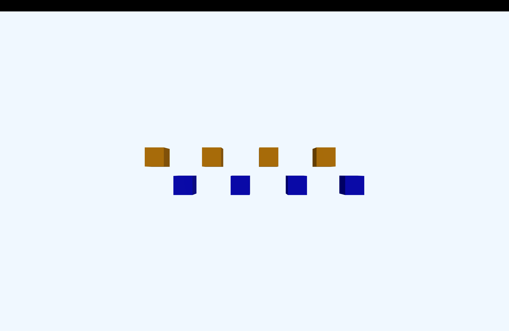

# Threepp (Øving 2)

Programmet viser åtte blå bokser som beveger seg opp og ned
i en sinusbevegelse. Annenhver boks er forskjøvet en halv
periode, slik at én gruppe beveger seg opp når den andre
beveger seg ned.

Trykk på mellomromstasten for å skifte farge på annenhver
boks. Gruppene endrer farge etter tur og veksler mellom
blå og oransje.

Antallet bokser kan endres med variabelen `antall` i `main.cpp`.

